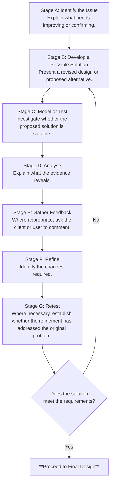

# Grid 5: Development of Design Ideas

## Development of Design Ideas
- *Maximum marks: 9*
- *Indicative portfolio space: approximately 4–6 A3 sides*

**What are you trying to achieve?**

You must demonstrate how research, technical understanding, modelling, testing and feedback have influenced the development of your design.

This is where your initial concepts should evolve into a more detailed and appropriate solution.

You need to show evidence of improvement, not simply additional drawings.

## 5.1 Identify what needs developing

Review your initial ideas and specification.

**Break your development work into areas such as:**
-	Overall proportions.
-	Structural arrangement.
-	Movement and mechanisms.
-	Material selection.
-	Joining methods.
-	Ergonomics.
-	Appearance.
-	Assembly.
-	Maintenance.
-	Manufacturing feasibility.

Prioritise the areas that present the greatest uncertainty or risk.

## 5.2 Plan purposeful design investigations

Every model or experiment should answer a question.

!!! example "Questions to ask yourself?"
    -	Will the proposed joint provide sufficient rigidity?
    -	Does the folding mechanism operate correctly?
    -	Is the handle comfortable to grip?
    -	Can two components be assembled accurately?
    -	Is the proposed material thickness suitable?
    -	Does the product fit within the intended space?

Avoid creating models simply because you believe the portfolio needs more photographs.

## 5.3 Use physical modelling

**Depending on what you are investigating, you might create:**
-	Card models.
-	Foam models.
-	Full-size mock-ups.
-	Scale models.
-	Joint samples.
-	Mechanism prototypes.
-	Material test pieces.
-	Sub-assemblies.

Choose materials appropriate for the question being investigated.

A card model may be useful for understanding proportions but may not provide meaningful evidence of structural strength.

A joint sample manufactured from the proposed final materials may be more suitable for testing fit or construction.

## 5.4 Use CAD modelling and simulation

**CAD can help you investigate:**
-	Dimensions and proportions.
-	Component relationships.
-	Clearances.
-	Assembly.
-	Movement.
-	Material usage.
-	Alternative configurations.

Where appropriate and available, simulations may help investigate mechanical or structural behaviour.

However, do not assume that a simulated result automatically demonstrates real-world performance.

The reliability of a simulation depends on the assumptions, inputs and methods used.

## 5.5 Develop a test method

**Before testing a model, identify:**
1.	What you want to find out.
2.	Which feature you are investigating.
3.	What you will measure or observe.
4.	What result would indicate success.
5.	What equipment you require.
6.	How you will record the results.
7.	What limitations the test may have.

This makes your development more systematic.

## 5.6 Record an iterative development cycle

Use the following process for each important design investigation.

## 5.7 Record iterations clearly

Use an iteration log to show how your design has evolved.

| Development Stage | Issue Investigated | Evidence Collected | Decision Made | Next Action |
|---|---|---|---|---|
| **1** | Initial folding arrangement | Card model showed limited clearance | Relocate the pivot point | Update CAD model |
| **2** | Revised pivot position | CAD indicated improved clearance | Develop a physical mechanism model | Manufacture test assembly |
| **3** | Joint stability | Physical test identified movement | Investigate alternative bracing | Produce revised joint |
| **4** | Revised support | Test showed improved rigidity | Continue with revised arrangement | Update final design |

These are illustrative findings rather than results from a real test.

## 5.8 Apply technical knowledge to your decisions

Your development should demonstrate understanding of relevant properties and processes.

**For example, when selecting a joint, consider:**
-	Loads acting on the component.
-	Material properties.
-	Strength and rigidity.
-	Manufacturing accuracy.
-	Ease of assembly.
-	Repairability.
-	Appearance.
-	Cost.

Explain why a particular approach is appropriate and what alternatives were considered.

## 5.9 Undertake comparative testing
Where useful, compare alternative materials, components or construction methods.

For example, you might compare two joint designs.

A good comparison should use an appropriate and consistent method so that results are meaningful.

**Consider:**
-	What is being compared?
-	Which variables should remain consistent?
-	What evidence will be collected?
-	What are the limitations of the test?
-	Which option performs better against the design requirements?

## 5.10 Use client feedback to refine the design

Your client should influence meaningful design decisions.

**You might ask them to:**
-	Test a full-size mock-up.
-	Compare alternative mechanisms.
-	Review proportions.
-	Comment on accessibility.
-	Compare finishes.
-	Evaluate ease of use.

Record their responses and explain what you decided to do.

You do not have to accept every suggestion.

If a suggestion creates a technical problem, explain why you have chosen an alternative.

## 5.11 Demonstrate significant development

By the end of this stage, the development of your design should be visible.

**You may have:**
-	Changed the overall form.
-	Revised dimensions.
-	Altered the construction.
-	Selected different materials.
-	Improved a mechanism.
-	Changed a joint.
-	Reduced unnecessary components.
-	Improved ergonomics.
-	Simplified manufacture.
-	Improved the appearance.

Not every change has to be dramatic, but each should have a clear purpose.

## 5.12 Produce a development conclusion

Summarise the most important changes made during development.

**Explain:**
-	What the original problem was.
-	What was investigated.
-	Which evidence informed your decision.
-	Which design features changed.
-	Why the final approach is more appropriate.

**Common weaknesses to avoid**
-	Redrawing the same idea repeatedly.
-	Producing CAD images without investigation.
-	Creating models without testing them.
-	Recording feedback without acting on or evaluating it.
-	Claiming that a change is better without evidence.
--	Selecting materials without considering properties.
-	Failing to explain unsuccessful experiments.
